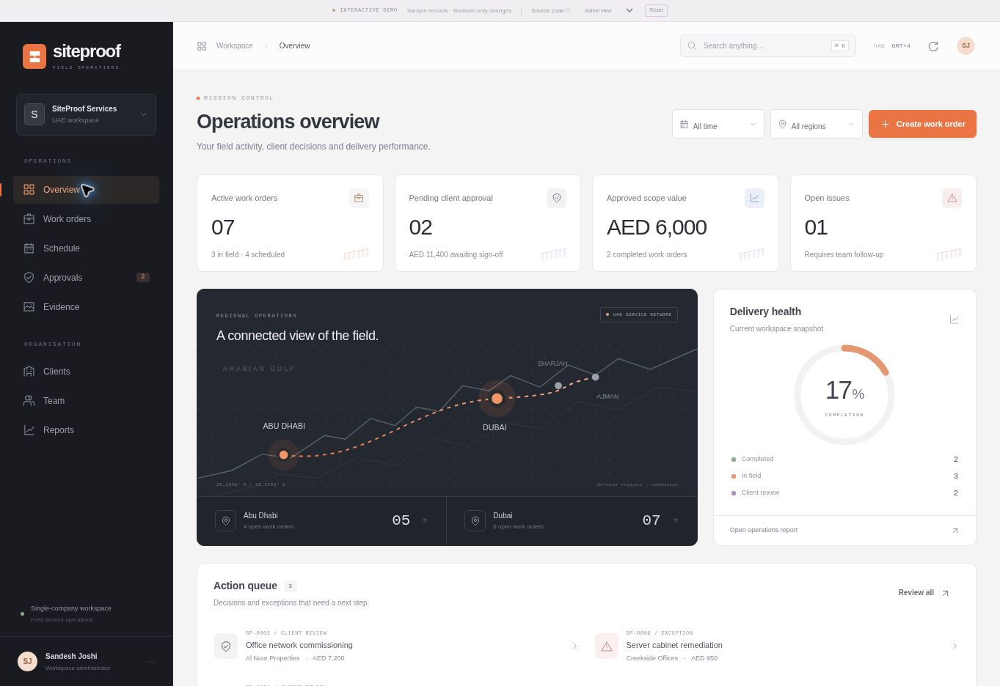
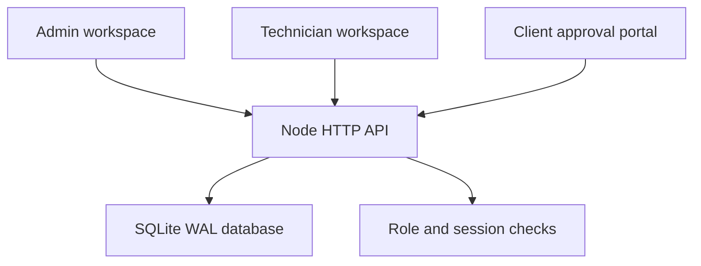

# SiteProof UAE
### Field operations. Evidence. Client sign-off.

A full-stack service-delivery workspace for maintenance, CCTV and IT installation teams in Dubai and Abu Dhabi. Track jobs from site visit to evidence collection, scope-change approval and client sign-off.

**Built by Sandesh Joshi** · [GitHub](https://github.com/sandesh1664)



## Version 2 — operations workspace

- Data-driven operations dashboard with regional service schematic and delivery health. The regional visual is a schematic, not GPS tracking.
- Five-stage work-order board and a compact register with task progress, assignees and scope values.
- Dedicated approval desk, evidence inspector, client records and assignment dialogs.
- Command search (`Cmd/Ctrl + K`), region/status filters and a navigable seven-day dispatch calendar.
- Delivery workspace with a lifecycle stepper, readiness checks, scope-change control, commercial summary and activity log.
- Redesigned client handover portal and printable service record.
- Responsive layouts verified in a 390 px viewport.

[Live interactive preview](https://siteproof-uae-sandesh.redmugitsolution11.chatgpt.site) — sample records, browser-local persistence. It does **not** connect to the Node/SQLite backend. Preview portal links work in the same browser only. The full-stack mode below uses the real server and database.

## Run in 30 seconds

Requires **Node.js 24** (22.13+ supports the SQLite API). No npm dependencies, paid API keys or build step.

```bash
git clone https://github.com/sandesh1664/SiteProof-UAE.git
cd SiteProof-UAE
npm start
```

Open http://localhost:3000. The first run creates a persistent SQLite database and six clearly illustrative demo jobs.

| Account | Email | Local demo password |
| --- | --- | --- |
| Administrator | admin@siteproof.ae | SiteProof2026! |
| Technician | tech@siteproof.ae | SiteProof2026! |

To start without demo records, set `SEED_DEMO=false` before the first run. Users are created once; changing environment passwords after initialisation does not update existing accounts.

## Product features

- Industrial graphite, off-white and burnt-orange interface with an operations overview, board and table views, seven-day dispatch schedule, dedicated client review desk, evidence library, client records, team assignments and reports.
- Administrator and technician accounts, scrypt password hashing, expiring HttpOnly cookie sessions, login throttling and same-origin write checks.
- Persistent jobs, technician assignment, four-step checklist, status workflow and activity timeline.
- Before/after/inspection evidence with optional PNG, JPEG or WebP uploads (4 MB client limit; 7 MB request limit).
- Extra-work requests with client approval or rejection, separate from original scope.
- Secure random client links; admins can rotate links to revoke access.
- Public client portal with name, approval/issue decision, comments and recorded time.
- Completion requires a client decision. Requests for sign-off require a finished checklist and evidence.
- Printable handover including scope, checklist, images, changes and client decisions. Choose **Save as PDF** in the browser print dialog.
- Template-based client summary, clipboard sharing, Google Maps directions and spreadsheet-safe CSV export.
- Docker configuration, CI and automated API integration tests.

## Walkthrough

1. Sign in as admin and create a job; assign a technician.
2. Sign in as that technician to see only assigned jobs.
3. Mark the job In progress, finish the checklist, and add evidence.
4. Admin can request extra work before submitting the handover.
5. Change status to Awaiting approval and copy the client link.
6. In the client portal, decide pending extra work and approve completion or report an issue.
7. Print the final handover. The audit timeline records the client decision.

Completed or submitted jobs must be reopened before changing checklist/evidence/scope. Reopening retains prior decisions as history. Client names are self-declared; the portal is not an identity-verified electronic signature service.

## Build the interactive demo

```bash
npm run preview:build
```

Serve the generated `dist/` directory with any static server. The demo automatically opens an illustrative admin workspace and includes a role switcher, 12 sample work orders and five sample team members. It is a demonstration transport, not authentication. The real Node server never serves `demo.js` and never loads it.

## Architecture



The browser uses ES modules and custom CSS. The server uses Node's HTTP, SQLite and crypto libraries. No CDN, external fonts, build tool or third-party runtime dependency is needed. This is deliberately a portable full-stack implementation rather than a framework starter.

```
public/               Shared operations UI, client portal, and isolated demo transport
 scripts/             Reproducible static preview builder
server.mjs            HTTP routing, database schema, authentication, workflow
 tests/system.test.mjs API integration tests (temporary isolated database)
 data/                Persistent SQLite database; ignored by Git
 .github/workflows/   Automated checks on push / PR
 Dockerfile           Node 24 container, non-root process
 compose.yaml         Production-oriented persistent deployment
```

### API overview

| Method | Route | Permission |
| --- | --- | --- |
| POST | /api/login | Public, throttled |
| GET | /api/me | Signed in |
| POST | /api/logout | Signed in |
| GET / POST | /api/jobs | Read own assignments / admin create |
| GET | /api/jobs/:id | Admin or assigned technician |
| POST | /api/jobs/:id/status | Admin or assigned technician |
| POST | /api/jobs/:id/task | Admin or assigned technician |
| POST | /api/jobs/:id/evidence | Admin or assigned technician |
| POST | /api/jobs/:id/variation | Admin |
| POST | /api/jobs/:id/share | Admin; revokes old link |
| GET / POST | /api/team | Signed-in read / admin create |
| GET | /api/public/:token | Bearer-link client access |
| POST | /api/public/:token/variation | Bearer-link client decision |
| POST | /api/public/:token/decision | Bearer-link handover decision |

## Validation

```bash
npm run check
npm test
```

Integration tests cover authentication, technician isolation, invalid evidence, checklist gating, scope-change decisions, client completion, replay prevention, link revocation and logout.

## Deployment

This app needs a persistent Node server. **GitHub Pages cannot run its backend.** Deploy to a VPS or a container platform with a durable volume. Terminate HTTPS with a reverse proxy.

```bash
cp .env.example .env
# Edit .env: use unique random passwords and your actual HTTPS origin.
docker compose up --build -d
```

Production cookies require HTTPS. `PUBLIC_ORIGIN` must match the browser origin exactly. Put the server behind HTTPS; do not use production mode over plain HTTP. Node itself does not load `.env`; Docker Compose does. For manual runs, export the variables in your shell.

| Variable | Default | Purpose |
| --- | --- | --- |
| PORT | 3000 | HTTP listener |
| DATA_DIR | ./data | Persistent database directory |
| ADMIN_PASSWORD | Local demo only | Initial administrator password; mandatory in production |
| TECH_PASSWORD | Admin password fallback | Initial technician password; set separately in production |
| SEED_DEMO | true | Set false before initialisation for an empty workspace |
| NODE_ENV | unset | production enables Secure cookies |
| PUBLIC_ORIGIN | request host over http | Browser origin for write checks |

Back up the SQLite database with a SQLite-aware backup tool, or stop the process before copying the entire data directory (including WAL files). Test restoration before using it for real records. Protect volumes and backups because photos and contact details are sensitive.

## Scope and next steps

This is a functional single-company portfolio system. It is not a multi-tenant SaaS deployment. Database migrations currently initialise the schema; introduce versioned migrations before changing a live database. Photos are base64-backed in SQLite for easy local setup; use object storage and image decoding/scanning for high-volume production. There is no billing, VAT invoicing, payment processing, email/SMS delivery, AI provider, Arabic localisation, MFA, password reset, account deactivation or verified signature service yet. Summaries are transparent templates, not AI output. Add those capabilities only after integrating and testing the corresponding providers.

Client links grant access to job evidence; share them privately and rotate them when needed. Evidence timestamps and approval names document submitted records and do not independently prove the work or identity.
